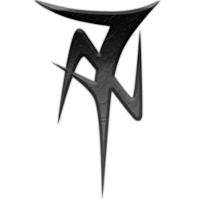
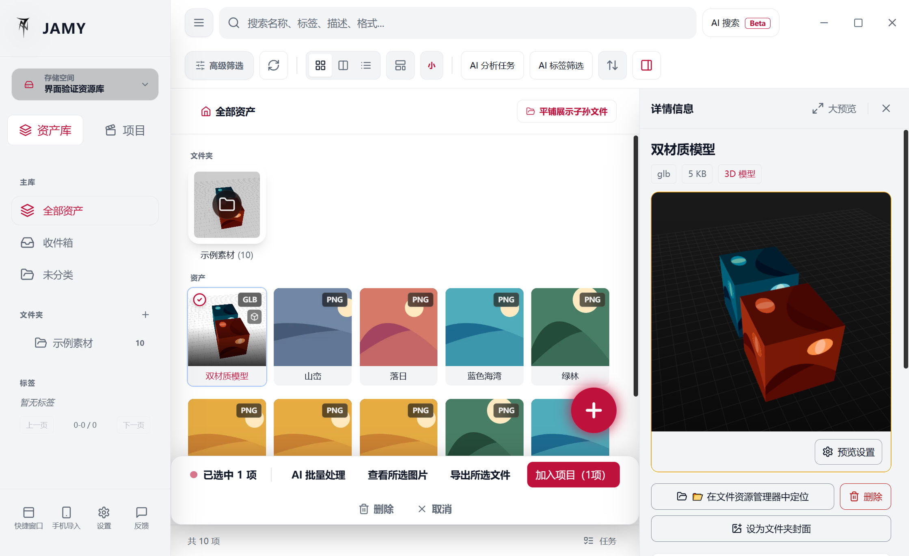
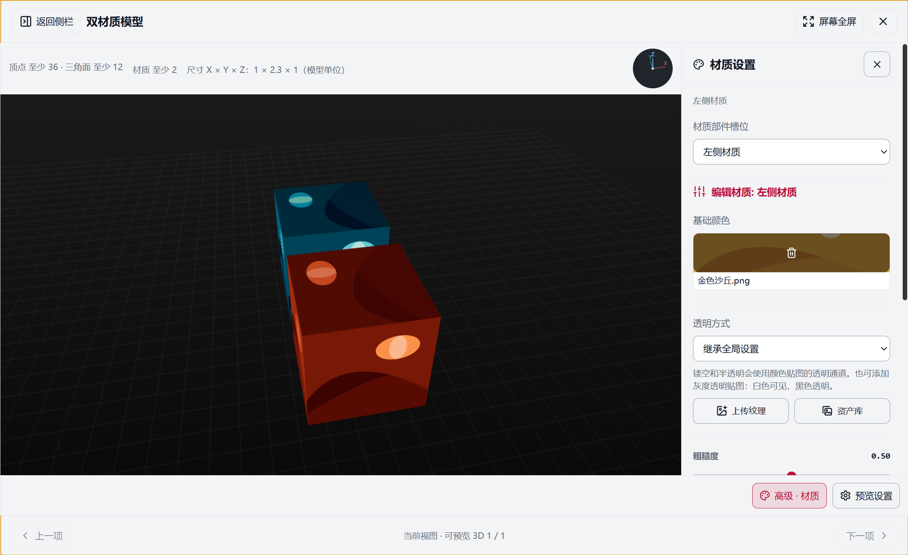
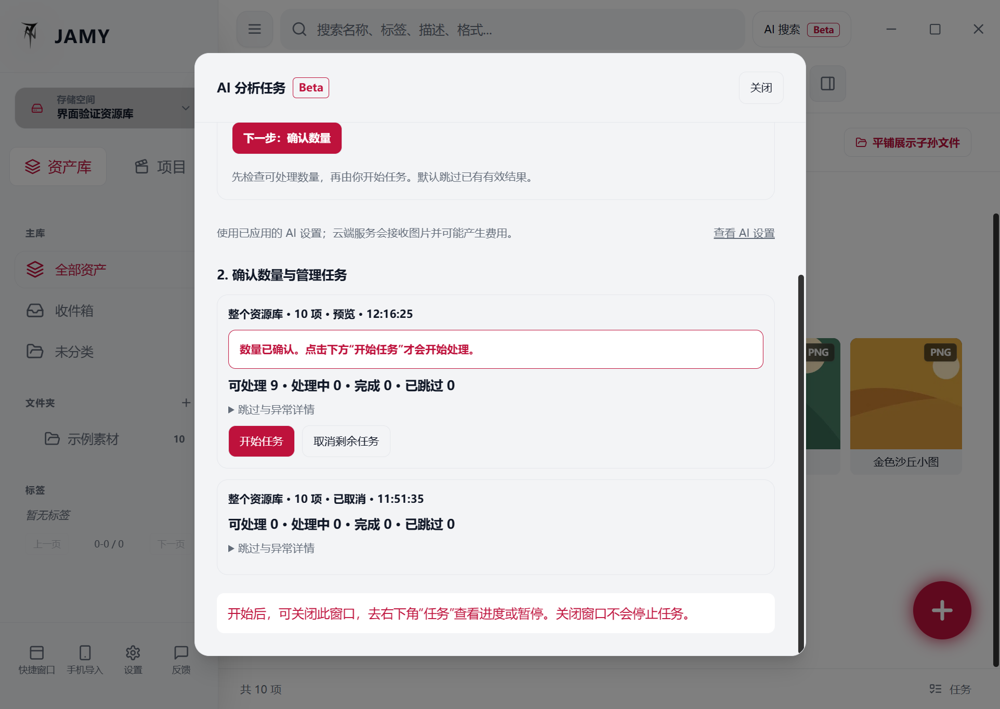
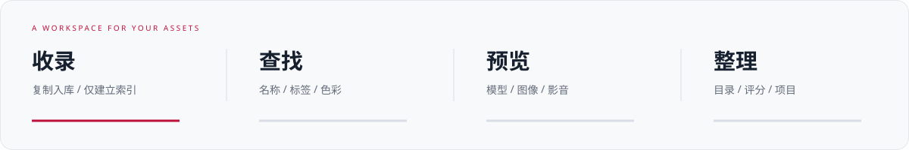

  <picture>
    <source media="(prefers-color-scheme: dark)" srcset="release/assets/jamy-mark-red.png" />
    
  </picture>

<strong>JAMY &nbsp; / &nbsp; DIGITAL ASSET MANAGER</strong>

<h1 align="center">你的素材，创作的下一步。</h1>

  把模型、材质与灵感，收进一个本地工作空间。 
  面向 3D、CG 与游戏美术工作流，连接素材的收录、查找、预览与整理。

  
  &nbsp;
  

  <a href="#features">探索功能</a>
  &nbsp; · &nbsp;
  <a href="release/manual/3.1.13/README.md">使用手册 · 29 章</a>
  &nbsp; · &nbsp;
  <a href="#formats">支持格式</a>
  &nbsp; · &nbsp;
  <a href="#limits">使用上限</a>
  &nbsp; · &nbsp;
  <a href="release/CHANGELOG.md">更新日志</a>
  &nbsp; · &nbsp;
  <a href="#download">安装与下载</a>

 

  

Windows 3.1.13 · 免费测试发布 · 默认亮色 · 实际 GLB 模型与图片样例库

> **现在下载的是 3.1.13 免费测试版本。** AI 图片分析与搜索仍带有 Beta 使用边界。安装前请备份已有素材库；升级后的库不能直接交给旧版打开。[版本说明](release/3.1.13.md) · [安装包与校验值](https://github.com/NortonJyC/JAMY-Release/releases/tag/v3.1.13)

**2026-10-30 更新构建**：新增包内 29 章离线手册，首次启动使用简短的“免费测试说明”；版本号仍为 3.1.13。已下载 10 月 29 日包的用户，可重新下载本次更新包。

 

## 看得清，找得快，用得上。

模型的材质、图片的配色，都可以成为下一次创作的起点。在同一个工作空间中，先看清素材，再决定如何使用。

<table>
  <tr>
    <td width="50%" valign="top">
      <h3>01 &nbsp; 看见模型本身</h3>
      
直接查看真实模型和贴图，调整灯光、HDRI 与单个材质。支持骨骼显示、姿态保存及符合条件的同模型动画混合。

      
    </td>
    <td width="50%" valign="top">
      <h3>02 &nbsp; 看清范围，再开始分析</h3>
      
AI 任务先检查可处理数量，再由你开始。分析、等待与异常集中查看；图片分析和 AI 搜索准备各有自己的步骤。

      
    </td>
  </tr>
</table>

 

### 03 &nbsp; 整理一次，让素材持续可用。

从文件夹、标签和评分，到项目、章节、场景与镜头，把分散的素材组织成自己的创作资源库。同一素材可以参与多个项目，并按参考、模型、动作或提示词等用途区分，不必反复复制。

### 04 &nbsp; 用自己的话，重新找到它。

本地 AI 或自定义 API 可为支持的图片生成描述与标签，再准备 AI 搜索，尝试按画面含义找回素材。图片分析与搜索准备分别配置；人工标签与纠正描述保留你的判断。官方 JAMY 云端服务尚未开放，自定义 API 的费用由服务商收取。

[从第一张图片到 AI 短片素材工作台，阅读完整使用手册 →](release/manual/3.1.13/README.md)

  

选择适合自己的收录方式

- **复制入库**：将素材复制到当前资源库，方便集中归档。
- **仅建立索引**：保留原文件位置，减少大型素材的重复复制。素材依赖原目录与存储盘，移动或删除源文件可能使关联失效。

 

## 日常会用到的功能

- **收录与多资源库**：本机文件与目录拖入、复制入库或仅建立索引；按项目建立和切换独立资源库。已有库可扫描收录，目录同步按对应入口和设置执行。
- **Quick 与手机收录**：快捷窗口收录与搜索；Windows 打包版在入口可用时支持“发送到 JAMY Quick”。手机收录使用手动开启的局域网服务，文件确认后入库。
- **浏览与搜索**：对齐网格、瀑布流、详细列表、缩略图尺寸与排序；结合名称、格式、类型、标签、评分和颜色筛选查找素材。
- **分类与项目**：目录分类、标签与星级评分；项目可组织章节、场景与镜头，同一资产可关联多个项目和用途。组合筛选可动态选片；本版没有智能文件夹创建、打开或管理入口。
- **图像与色板**：详情预览、独立图片查看器、主要颜色与占比提取；色板可复制为 JSON、CSS 或导出为 ASE。PSD 以合成图预览，不提供图层编辑。
- **模型与动画**：支持的模型可交互预览，调整整体或单个材质贴图、灯光、HDRI、旋转与跟随；可保存预览封面、查看和简化骨骼、保存姿态与尝试兼容的同模型动画混合。GLTF 替代贴图单独保存；不等于任意角色动作重定向或动画导出。
- **AI 分析与搜索（Beta）**：静态 PNG/JPEG/WebP 图片分析、批量与新导入自动任务、AI 标签筛选、人工纠正描述、语义搜索。支持本地组件准备或自定义 API，暂停、继续和异常处理集中到任务中心。
- **音视频与文本**：视频播放与可取得的媒体信息；音频整段波形、播放进度和跳转；文本与代码以只读方式查看，长文件截取有界内容。
- **批量整理与任务**：支持的库可批量修改显示名、单个或批量移入分类目录，查看收录结果和后台任务。部分大批次复制支持分段暂停、继续和恢复。
- **维护与恢复**：资源库记录备份与恢复、源文件缺失提示、符合条件时重新定位或补回图片。手动备份独立保留，不参与自动最近 5 份轮换。数据库快照不包含素材原件，素材和外部贴图应另行备份。
- **主题与界面**：默认亮色，可选择深色、蓝色、柔和绿或暖咖啡；支持中文和英文界面。

> 本页对应 **Windows 3.1.13 · 2026-10-30 免费测试构建**。官方云端 AI、账号支付、多用户协作和 macOS 安装包不在本次发布范围。软件内已提供 29 章离线手册，本仓库同时保留正文、章节索引和独立 HTML 阅读版。

 

## 支持哪些资产格式？

**“可以收录”与“可以直接预览”是两件事。** 下表按 3.1.13 格式登记表列出；具体编码、文件依赖和资源上限仍会影响预览。

| 类别 | 扩展名 | 在 JAMY 中的使用方式 |
| --- | --- | --- |
| 常用图像 | PNG · JPG · JPEG · WEBP · GIF · BMP · AVIF · SVG · ICO | 收录、缩略图与图像预览；动图、多页、矢量和特殊编码不承诺完整还原 |
| 专业图像与贴图 | TGA · PSD · TIF · TIFF · HDR · EXR | 受控解码与预览；PSD 使用合成图，HDR/EXR 不是完整色彩制作工具 |
| 需逐文件确认的图像 | RAW · DNG · IFF · PICT | 已登记可收录；解码兼容性取决于编码，不能视为通用相机 RAW 支持 |
| 交互式 3D | GLB · GLTF · FBX · OBJ · STL · PLY · DAE · BVH | 符合格式与大小限制时交互预览；BVH 用于骨骼动作预览 |
| 仅收录管理的 3D/包文件 | BLEND · UNITYPACKAGE · 3DS · ABC · USD · USDZ | 占位图、分类与外部打开，不提供 WebGL 实时预览 |
| 视频 | MP4 · WEBM · MOV · AVI · MKV · M4V | 管理与可解码内容的播放；扩展名不代表内部视频/音频编码一定受支持 |
| 音频 | MP3 · WAV · OGG · AAC · FLAC · M4A | 管理与可解码内容的播放；整段波形另有大小、时长和采样上限 |
| 文本文档 | TXT · MD · MARKDOWN · JSON | 只读内容预览，长文件截断 |
| 代码与脚本 | JS · TS · PY · C · CPP · H · CS · HTML · CSS · XML · BAT · SH | 只读代码预览，不在预览中运行脚本 |

模型的 `.bin` 与 `.mtl` 作为依赖文件处理，不作为独立资产收录。请保留模型与相关贴图、材质文件的有效关联。

 

## 使用前，先了解这些上限

**建议按项目、用途或年度分库。** 当前尚未建立跨硬件实机验证的统一“每库推荐资产数”，因此不承诺某个数量以内始终流畅。部分查询、建库扫描与旧库迁移以 **20 万资产 / 5 万目录** 为保护边界；这不是推荐存放量，也不是无限容量或性能保证。

| 场景 | 当前主要边界 | 对使用的影响 |
| --- | --- | --- |
| 模型预览 | FBX / OBJ / DAE 最高 **64 MiB**；STL / PLY **128 MiB**；GLB / GLTF **256 MiB**；BVH **8 MiB** | 自动预览阈值更低，大文件需手动确认；体积合格也可能因场景复杂度或内存不足而无法预览 |
| 普通图片缩略图/受控解码 | 文件最高 **512 MiB**，单页最高 **4,000 万像素** | 8K 方图约 6,711 万像素；HDR / EXR / PSD 等不能按“支持格式”推断支持任意 8K/16K 文件 |
| 独立大图查看器 | 文件最高 **256 MiB**，每边最高 **16,384 像素** | 符合条件的非渐进 JPEG、非交错单帧 PNG 有大图专用路径；不是所有图片格式都放宽到 16K |
| 整段音频波形 | 文件最高 **64 MiB**、时长最高 **60 分钟**，还受总采样量与声道数限制 | 波形超限不等于普通音频播放被禁止 |
| 文本/代码预览 | 最多读取前 **256 KiB** | 大文件可以管理，但预览不是完整文件编辑器 |
| AI 图片分析与搜索 | 分析限静态 PNG/JPEG/WebP；AI 搜索单库处理最多 **20 万项**，查询最多 **512 字符** | 先分析图片，再准备搜索；AI 结果可能不准确，搜索上限不是资产导入上限 |
| 导入与批量操作 | 不同入口有不同单次上限；批量改显示名为 **1–200 项** | 目录导入、普通多文件、Quick 和手机入口不能共用一个“无限批量”承诺 |

**这些是保护边界，不是最低可运行保证。** 内存、显卡、磁盘空间、文件编码和外部依赖仍会影响实际结果。超限或解码失败不等于原文件已损坏。

[查看完整容量、模型、图片与导入限制 →](release/LIMITS.md)

 

## 使用手册：从入门，到自己的创作工作流

完整文字版包含 **29 章、8 个进阶玩法**，适用 Windows 3.1.13 中文界面。

- [完整目录与阅读入口](release/manual/3.1.13/README.md)
- [第一次使用：导入、查看、标记、找回与取用](release/manual/3.1.13/JAMY-使用手册-3.1.13.md#chapter-01)
- [模型、材质与预览封面](release/manual/3.1.13/JAMY-使用手册-3.1.13.md#chapter-10) · [骨骼、动画与保存姿态](release/manual/3.1.13/JAMY-使用手册-3.1.13.md#chapter-11)
- [AI 配置与图片分析](release/manual/3.1.13/JAMY-使用手册-3.1.13.md#chapter-13) · [AI 标签、搜索与任务](release/manual/3.1.13/JAMY-使用手册-3.1.13.md#chapter-14)
- [玩法 3：AI 短片素材工作台](release/manual/3.1.13/JAMY-使用手册-3.1.13.md#chapter-22)
- [资源库、备份、迁移与恢复](release/manual/3.1.13/JAMY-使用手册-3.1.13.md#chapter-18) · [常见问题](release/manual/3.1.13/JAMY-使用手册-3.1.13.md#chapter-28)

软件内可从“设置 → 使用手册”离线阅读完整内容，支持目录、章节定位与正文搜索。文字手册保留版本标记，后续按真实界面补图。也可下载独立 HTML 阅读版后用浏览器打开；GitHub 文件页展示的是 HTML 源码。

 

## 让下一次创作，从这里开始。

本次发布 **JAMY 3.1.13 免费测试版（Windows）**。安装包通过本仓库 **GitHub Releases** 分发，不计入 Git 源码历史。安装前关闭旧版 JAMY；此包尚未进行数字签名。升级前请独立备份素材原件与资源库记录。

普通用户只需下载并安装 `JAMY_Install_3.1.13.exe`。同页的 [`JAMY_ThirdParty_Source_3.1.13.zip`](https://github.com/NortonJyC/JAMY-Release/releases/download/v3.1.13/JAMY_ThirdParty_Source_3.1.13.zip) 是第三方组件源码、构建配方与许可附件，**无需安装**，不包含 JAMY 业务源码或用户素材。

  <a href="https://github.com/NortonJyC/JAMY-Release/releases/tag/v3.1.13"><strong>下载 JAMY 3.1.13 →</strong></a>
  &nbsp; &nbsp;
  <a href="release/CHANGELOG.md">查看更新记录</a>
  &nbsp; &nbsp;
  <a href="https://jamy-asset-manager.nortoncjy148.chatgpt.site/">访问官网</a>

 

---

发行资料与素材来源

本仓库用于 JAMY 软件发行，包含公开产品资料、更新日志与发布说明。安装包作为 Release 附件提供。

- [`release/`](release/)：公开发行资料与发布说明。
- [`release/CHANGELOG.md`](release/CHANGELOG.md)：版本更新记录。
- [`完整使用手册`](release/manual/3.1.13/README.md)：目录、正文与离线阅读版。
- [`3.1.13 发布说明`](release/3.1.13.md)：安装提示、已知范围与 SHA-256。
- [`截图与样例素材来源`](release/assets/CREDITS.md)：截图说明、样例素材作者与许可。

网站由独立的 `JAMY-Website` 仓库维护。本仓库不包含软件源码、内部构建脚本或私有配置。

JAMY Digital Asset Manager &nbsp; · &nbsp; NortonJy &nbsp; · &nbsp; Windows 3.1.13

